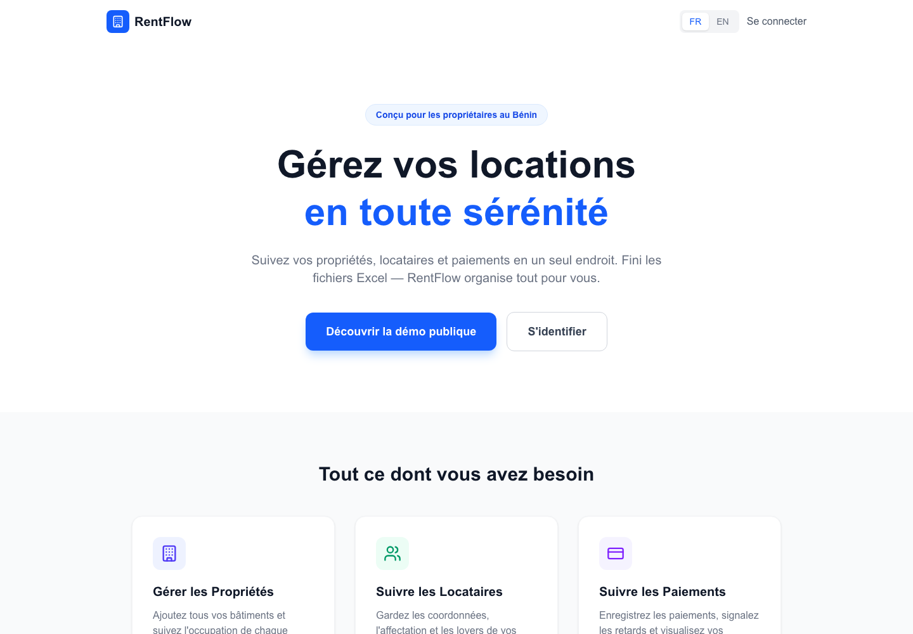
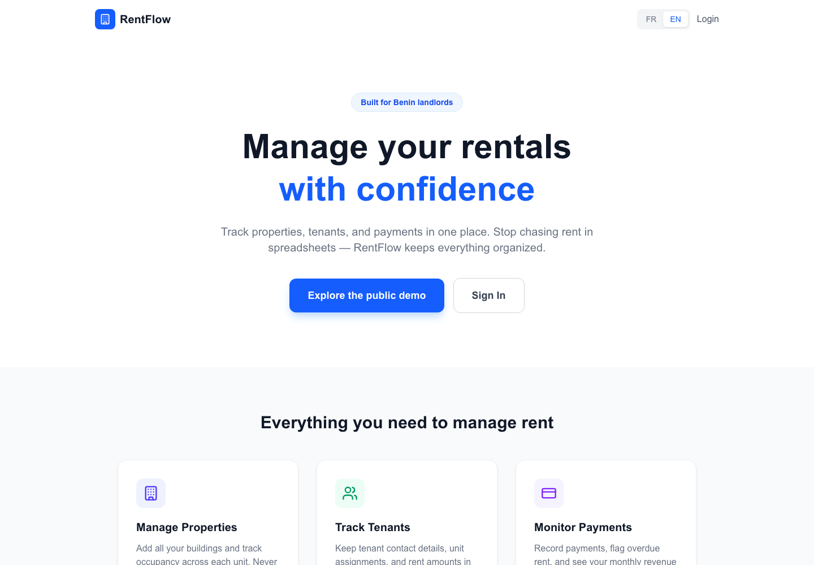

# RentFlow Bénin

[English](README.md) · [Français](README.fr.md)

Application bilingue de gestion locative pour les propriétaires au Bénin.
Gérez les biens, les locataires, les loyers en FCFA et les dépenses depuis un
tableau de bord.

## Démo publique

Ouvrez [rentflow-benin.vercel.app](https://rentflow-benin.vercel.app/) et
choisissez **Découvrir la démo publique**, puis **Continuer comme invité**.
Aucun mot de passe partagé n’est nécessaire. Les données affichées sont des
exemples fictifs, les écritures et les inscriptions sont bloquées.

La démo publique actuelle utilise des fixtures intégrées et ne se connecte pas
à une base de données. Elle ne contient aucune donnée réelle de propriétaire ou
de locataire et ne constitue pas la démo avec base isolée et ensemencée prévue
par l’issue #9.

## Captures d’écran

| Français | English |
|---|---|
|  |  |

## Fonctionnalités

- Comptes propriétaire sécurisés et sessions JWT.
- Gestion des biens, des locataires, des baux et des loyers.
- Suivi des paiements en FCFA, dépenses et rapports financiers.
- Reçus de paiement partageables par WhatsApp.
- Interface en français et en anglais.
- Démo publique sans mot de passe, en lecture seule, avec des exemples fictifs de Cotonou.

## Installation locale

Prérequis : Node.js 22 et npm. PostgreSQL est nécessaire uniquement pour le
mode connecté à une base de données.

```bash
git clone https://github.com/Yerima18/Rentflow-Benin.git
cd Rentflow-Benin
npm ci
cp .env.example .env
```

Les valeurs de `.env.example` sont réservées au développement local. Ne
commitez jamais `.env` ni des identifiants de production.

### Démo locale sans base

Gardez `DEMO_MODE="true"` et `DATABASE_URL` non défini, puis lancez :

```bash
npm run dev
```

La démo utilise uniquement les fixtures intégrées. Elle ne nécessite ni
migration ni identifiants de semis.

### Mode local connecté à PostgreSQL

Créez une base locale vide, configurez `DATABASE_URL` dans `.env`, puis mettez
`DEMO_MODE="false"`. Appliquez les migrations versionnées :

```bash
npm run db:migrate:dev
npm run dev
```

Pour créer les exemples fictifs de propriétaires, biens, locataires et
paiements, définissez `DEMO_SEED_EMAIL` et `DEMO_SEED_PASSWORD` dans `.env`,
puis exécutez :

```bash
npm run db:seed
```

Le semis est répétable, utilise des identifiants stables et refuse la
production par défaut. Il refuse aussi les bases distantes sans autorisation
explicite. N’utilisez ces options que sur une base de démo isolée, jamais sur
une base contenant des données réelles.

## Configuration Vercel

Pour publier la démo publique actuelle, ouvrez **Project Settings → Environment
Variables**, choisissez **Production**, puis définissez :

| Variable | Valeur Production |
|---|---|
| `DEMO_MODE` | `true` |
| `NEXTAUTH_URL` | `https://rentflow-benin.vercel.app` |
| `NEXTAUTH_SECRET` | Un nouveau secret généré, par exemple avec `openssl rand -base64 32` |

Pour cette démo avec fixtures intégrées, laissez `DATABASE_URL`,
`DEMO_SEED_EMAIL` et `DEMO_SEED_PASSWORD` non définis. `vercel.json` configure
déjà la commande de build ; aucune commande personnalisée n’est nécessaire.
Après avoir enregistré les variables, redéployez puis vérifiez la page
d’accueil, la connexion invité, le tableau de bord et le détail d’un bien.

Cette configuration n’utilise pas une base isolée ensemencée. N’ajoutez pas
`DATABASE_URL` à la démo publique en pensant qu’elle utilisera ces données : le
mode invité actuel lit les fixtures intégrées. Une instance connectée à une
base dédiée nécessite `DEMO_MODE=false`, une `DATABASE_URL` isolée, un secret
`NEXTAUTH_SECRET` et l’URL canonique `NEXTAUTH_URL`. Ne réutilisez jamais une
base de production contenant des données réelles pour la démo.

Pour une base existante créée avec `prisma db push`, sauvegardez-la et comparez
son schéma à la migration initiale avant de marquer celle-ci comme appliquée.
Ne lancez pas la migration de production sur une base non vérifiée. Les
déploiements de production non démo exécutent `prisma migrate deploy` avant le
build ; les builds de démo et de prévisualisation ne modifient pas le schéma.

## Tests et vérifications

```bash
npm ci
npm test
npm run smoke:demo
```

`npm test` couvre l’authentification, les accès API non authentifiés,
l’isolation entre propriétaires, les paiements et la validation des montants
entiers en FCFA avec des mocks, sans utiliser de base de données. Le smoke test
de démo vérifie l’accès invité, les pages en lecture seule, les exemples et le
blocage des écritures. GitHub Actions exécute le build de production, les tests
et le smoke test sur les pull requests et les pushs vers `main`.

## Limites connues

- La démo publique utilise des données fictives intégrées, pas une base isolée
  ensemencée.
- Les réglages Vercel et l’accès public à la démo doivent être vérifiés après
  chaque déploiement.
- Pour une base existante, le schéma et l’historique des migrations doivent
  être comparés avant toute migration de production.

## Technologies

Next.js, TypeScript, Tailwind CSS, PostgreSQL, Prisma, NextAuth et Vitest.

## Licence

MIT
